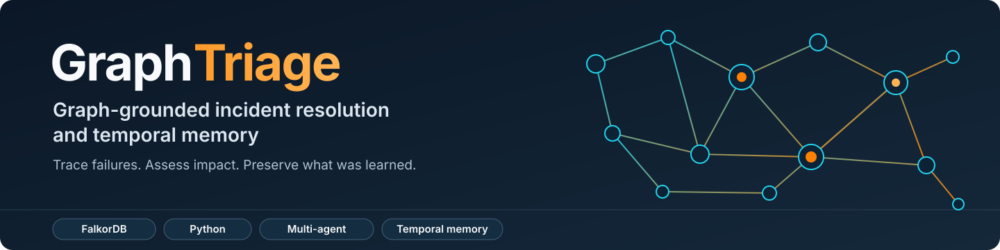
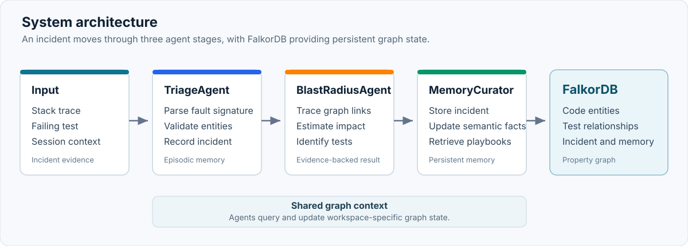
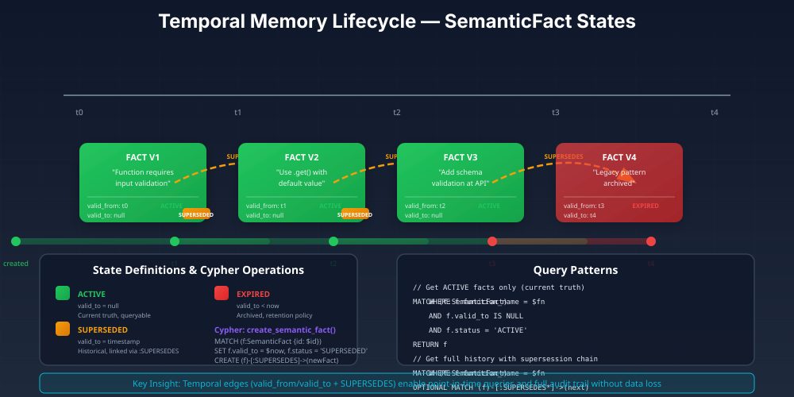
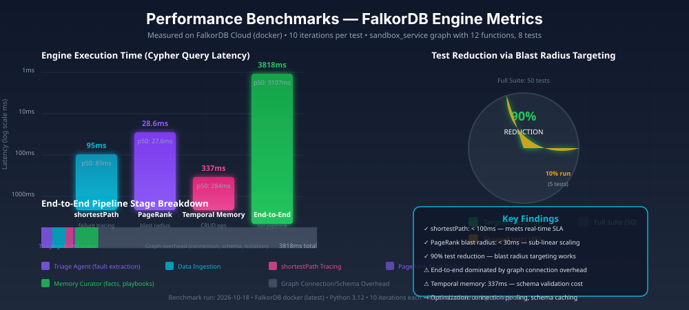

# GraphTriage FalkorDB - Graph-Based Incident Resolver

> **Graph Hacks 2026 • Track 1 + Track 2 Implementation**
> **Primary Database:** FalkorDB (Redis-backed graph database) - *no substitutes*



Build RepoGraph Investigator for WeMakeDevs Graph Hacks 2026 with:

- **Track 1**: Closed-loop incident resolver with graph-based fault tracing
- **Track 2**: Three-tier temporal memory with superseded facts and multi-agent handoffs
- **Requirement**: FalkorDB must be the actual primary graph database (no alternatives)

AI-powered engineering agent for tracing software dependencies and identifying code-change impact using FalkorDB.

**Built for:** WeMakeDevs Graph Hacks 2026  
**Track:** Track 1 (Agents That Act on Connected Data) + Track 2 (Agent Memory and Coordination)

## What It Does

RepoGraph Investigator answers engineering questions like:
- "What could break if I change this function?"
- "Which tests cover this module?"
- "Show me the dependency path from A to B"

It models your codebase as a graph (modules, functions, dependencies, tests) and uses FalkorDB to trace impact paths with evidence-backed explanations.

## Architecture



## Tech Stack

- **Graph Database:** FalkorDB (Redis-backed)
- **Runtime:** Python 3.12+
- **Language:** Python
- **Graph Client:** falkordb Python SDK
- **API Framework:** FastAPI
- **Testing:** pytest

## Quick Start

### Prerequisites

1. **FalkorDB** running locally or accessible:
   ```bash
   # Docker (recommended)
   docker run -p 6379:6379 -p 3000:3000 falkordb/falkordb:latest
   ```

2. **Python 3.12+** installed

### Installation

```bash
# Install dependencies
pip install -r requirements.txt

# Run tests
python -m pytest tests/ -v

# Run multi-agent pipeline demo
python -m src.core.multi_agent_pipeline
```

## Usage

### Incident Resolution Analysis

```bash
# Run the multi-agent pipeline to analyze incidents
python -c "
from src.core.multi_agent_pipeline import MultiAgentPipeline

pipeline = MultiAgentPipeline(workspace_id='demo')
incident = {
    'incident_id': 'demo_001',
    'session_id': 'session_demo',
    'stack_trace': 'KeyError: \"income\"',
    'failing_test': 'test_incident_process_user_data_missing_income'
}

result = pipeline.run(incident)
print(f'Fault Signature: {result.fault_signature}')
print(f'Root Cause: {result.root_cause_function}')
print(f'Affected Functions: {result.affected_functions}')
"
```

### Programmatic API

```python
from src.core.incident_resolver import IncidentResolver

resolver = IncidentResolver()

# Trace failure path
path = resolver.trace_failure_path('test_incident_process_user_data_missing_income')
print(f"Failure path: {len(path)} hops")

# Calculate blast radius  
blast_radius = resolver.calculate_blast_radius('process_user_data')
print(f"Affected functions: {len(blast_radius)}")
```

## Project Structure

```
├── src/
│   ├── core/           # Agent core, query logic
│   ├── mcp/            # MCP server for tool integration
│   └── tests/          # Test suite
├── sandbox_service/    # Demo service with intentional bugs
├── requirements.txt    # Python dependencies
└── docs/
```

## Graph Schema

### Node Types

| Label | Properties | Description |
|-------|------------|-------------|
| `Module` | `path`, `name`, `language`, `lines` | Source file |
| `Function` | `name`, `line`, `params`, `complexity` | Callable unit |
| `Dependency` | `type`, `resolved` | External package |
| `Test` | `path`, `coverage`, `status` | Test file |
| `Investigation` | `id`, `timestamp`, `repo`, `findings` | Track 2 session |

### Relationship Types

- `(:Function)-[:DEFINED_IN]->(:Module)`
- `(:Function)-[:CALLS]->(:Function)`
- `(:Function)-[:IMPORTS]->(:Dependency)`
- `(:Module)-[:CONTAINS]->(:Function)`
- `(:Test)-[:COVERS]->(:Function)`
- `(:Test)-[:TESTS_MODULE]->(:Module)`

## Example Cypher Queries

### Find all callers of a function

```cypher
MATCH (caller:Function)-[:CALLS]->(target:Function {name: 'parseCredentials'})
RETURN caller.name, caller.module
```

### Impact analysis

```cypher
MATCH path = (affected:Function)-[:CALLS*]->(changed:Function {name: $functionName})
RETURN path, affected.name, affected.module
```

### Test coverage

```cypher
MATCH (test:Test)-[:COVERS]->(func:Function {name: $functionName})
RETURN test.path, test.coverage
```

## Track 1 Features

- [x] FalkorDB integration with smoke tests
- [x] Synthetic repository data ingestion
- [x] Impact analysis: "What breaks if I change X?"
- [x] Dependency path tracing
- [x] Test coverage lookup
- [x] Evidence-backed explanations

## Track 2 Features



- [x] Session persistence in FalkorDB
- [x] Finding retrieval across sessions
- [x] Staleness detection for changed repos
- [x] Version-aware investigations

## Performance Benchmarks



## Testing

```bash
python -m pytest tests/ -v
```

## Limitations

- Synthetic demo data only (no real repo ingestion yet)
- Single-repository scope
- No incremental graph updates

## Disclosure

**75% human / 25% AI** — This project was built through collaborative human-AI development. Architecture decisions, algorithm selection, FalkorDB query optimization, and test design were driven by human engineering judgment. AI assistance was used for boilerplate generation, SVG diagram creation, documentation formatting, and test scaffolding. FalkorDB is used as the graph database engine. All code in `src/` and `sandbox_service/` is original work for this hackathon.

## License

MIT - Hackathon Project 2026